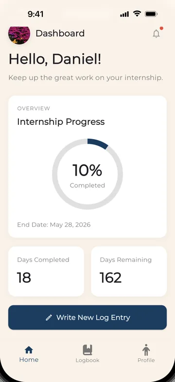
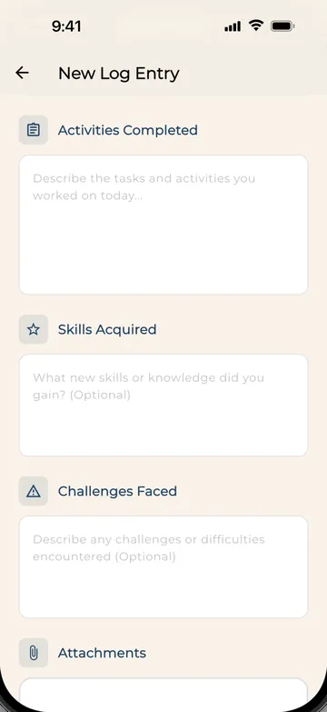
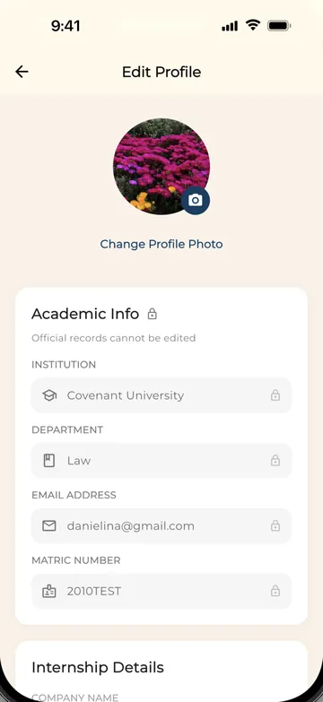
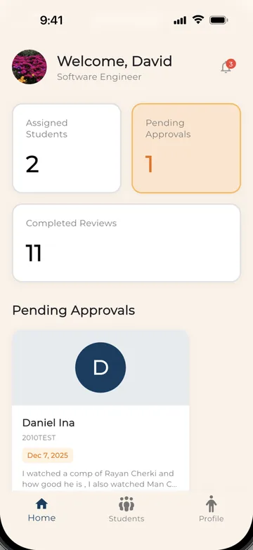
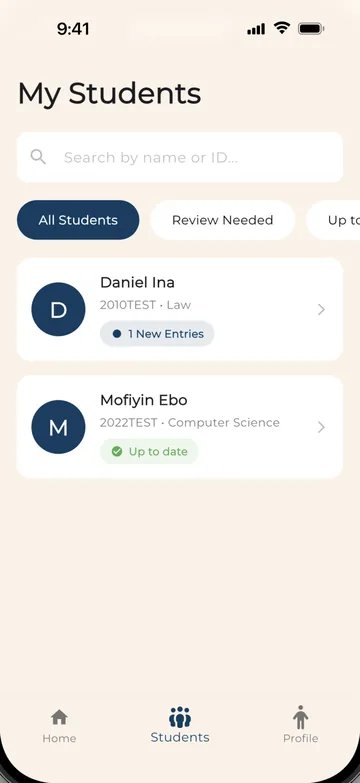

# SIWES360

A Flutter app that replaces the paper SIWES logbook: students log their daily industrial-training work, and their industry supervisors review, approve or reject each entry.

SIWES (Students Industrial Work Experience Scheme) is Nigeria's compulsory industrial-training programme for university students. SIWES360 gives students and supervisors their own role-based apps, backed by a REST API.

## Screenshots

| Student dashboard | Weekly logbook | New log entry |
| :---: | :---: | :---: |
|  |  |  |
| Progress through the internship, days completed and days remaining | Entries grouped by internship week, each with its review status | Activities, skills acquired, challenges and file attachments |

| Edit profile | Supervisor dashboard | Supervisor's students |
| :---: | :---: | :---: |
|  |  |  |
| Academic records are locked; internship details stay editable | Assigned students, pending approvals and a review queue | Search, filter by review status and open a student's logbook |

## Features

### Student

- **First-login setup:** on first sign-in, students enter their internship start and end dates, their workplace, and their industry supervisor. Typing a supervisor's name searches registered supervisors and links the account, so that supervisor can review the student's logs.
- **Dashboard:** internship progress (percentage complete, days completed, days remaining), recent entries, the assigned supervisor, and counts of total, approved, pending and rejected logs.
- **Daily logbook entries:** each entry has a date, the activities completed (at least 20 characters), and optional skills acquired and challenges faced. Students can attach PDF, Word, Excel, JPG or PNG files, up to 10 MB in total, uploaded as multipart form data.
- **Logbook:** entries are grouped by internship week and can be filtered by status (all, approved, pending or rejected) or jumped to by date from a calendar. Pending and rejected entries can be edited or deleted, and the supervisor's comment is shown on reviewed entries.
- **Profile:** shows personal, academic and internship details. Institution, department, email and matric number are read-only. Internship dates, workplace and supervisor details can be edited. The profile photo comes from the camera or gallery and is stored on the device.
- **Notifications:** an all/unread view, mark one or all as read, and swipe to delete.

### Supervisor

- **Self-registration:** industry supervisors create their own account (name, email, phone, organisation, position and password). Students are not self-registered; the app tells them their institution provides their login.
- **Dashboard:** counts of assigned students, pending approvals and completed reviews, a queue of entries waiting for review, and a notification badge.
- **Review entries:** approve an entry with an optional comment, or reject it with a required reason. The comment is saved with the entry and shown to the student.
- **My Students:** search assigned students by name or ID, filter them by "Review needed" or "Up to date", and open any student's full logbook.
- **Profile:** contact and organisation details (editable), the list of intern students, and the institutions they come from.
- **Notifications:** the same all/unread, mark-as-read and delete actions as students have.

### Shared

- Email and password sign-in against a JWT-issuing backend, with automatic sign-in on launch while the stored token is still valid.
- Role-based routing to the student or supervisor home screen.
- Sign-out, which clears the stored session.

## Tech stack

| Area | Choice |
| --- | --- |
| Framework | Flutter (Dart SDK `^3.9.2`) |
| Networking | `dio`, with an interceptor that attaches the bearer token |
| Local storage | `hive` / `hive_flutter` |
| State management | `provider` (app theme) and `StatefulWidget` state on each screen |
| Models | `json_annotation` + `json_serializable` (generated `*.g.dart`) |
| Files and media | `file_picker`, `image_picker`, `path_provider` |
| UI | Material 3 theme, Google Fonts (Montserrat), `intl` for dates, `url_launcher` |
| Backend | Node.js, Express and MySQL: [siwes360Backend](https://github.com/mofixiu/siwes360Backend) |

## Architecture

### State management

Screens are `StatefulWidget`s. Each one loads its data from the API in `initState` and keeps it in local state, with loading, error and retry states. A single `ThemeProvider` (`ChangeNotifier`, provided through `MultiProvider` in `main.dart`) controls the app's `ThemeMode`. Light and dark themes are defined in `lib/themes/theme.dart`.

### Authentication flow

1. **Login:** `POST /auth/login` returns a JWT and the user record, with role-specific fields under `role_data`.
2. **Storage:** the token is written to the Hive box `auth` (key `token`). The merged user and role data are written as JSON to the Hive box `user` (key `userData`).
3. **Request auth:** a Dio interceptor reads the token and sends it as `Authorization: Bearer <token>` on every request.
4. **Routing:** `RoleRouter` (`lib/utils/role_router.dart`) maps the stored `role` to a home screen. `student` goes to `StudentDashboard` and `supervisor` goes to `SupervisorDashboard`. A student whose `role_data.is_first_login` is set goes to `FirstLoginSetup` first.
5. **Auto-login:** on launch, `SplashScreen` loads the token and user data and validates them with `GET /auth/profile`. A valid session goes straight to the role's dashboard. An invalid or missing session is cleared and the user is sent to login.
6. **Logout:** both Hive boxes are cleared and the in-memory token is dropped.

### API layer

All HTTP calls go through `RequestService` in `lib/utils/request.dart`. It is a static wrapper around a single Dio instance (10-second connect and receive timeouts). It exposes typed methods for each resource: auth, students, daily logs, supervisors and notifications. It also has generic `get`, `post`, `put`, `patch` and `delete` helpers that turn errors into a `{status, message}` map instead of throwing.

The base URL is chosen by platform at the top of `request.dart`:

| Platform | Host |
| --- | --- |
| Android emulator | `http://10.0.2.2:3001` |
| iOS simulator, web, desktop | `http://localhost:3001` |

All requests go to `<host>/api`.

## Getting started

### Prerequisites

- Flutter with Dart SDK `^3.9.2` (`pubspec.yaml`)
- A running instance of the [SIWES360 backend](https://github.com/mofixiu/siwes360Backend), listening on port `3001`

### Run

```bash
git clone https://github.com/mofixiu/siwes360.git
cd siwes360
flutter pub get
flutter run
```

### Configuration

The app needs no API keys or `.env` file. The only setting is the backend host in `lib/utils/request.dart`:

- **Emulator or simulator:** the defaults work if the backend runs on the same machine on port `3001`.
- **Physical device:** replace the host with your machine's LAN IP, for example `http://192.168.1.x:3001` (there is a commented example in the file).

Student accounts are created on the backend, not in the app. Supervisors can register from the app's role-selection screen.

If you change a model in `lib/models/`, regenerate the serialisers:

```bash
dart run build_runner build --delete-conflicting-outputs
```

## Project structure

```
lib/
├── main.dart                 # App entry: Hive init, RequestService, providers, themes
├── auth/                     # Login, role selection, supervisor sign-up, password-reset screens
├── models/                   # json_serializable models (user, student, supervisor, daily_log, ...)
├── providers/                # ThemeProvider
├── screens/
│   ├── student/              # Dashboard, logbook, new entry, first-login setup, profile, settings, notifications
│   └── supervisor/           # Dashboard, students, student logbook, entry review, profile, settings, notifications
├── themes/                   # Light and dark ThemeData
├── utils/                    # RequestService (API + storage), RoleRouter, page transitions
└── widgets/                  # Splash screen, bottom nav bars, file and image pickers, buttons
```

## Author

Built by **Mofiyinfoluwa Ebo** ([@mofixiu](https://github.com/mofixiu)), who designed and built both the Flutter app and the [Node.js backend](https://github.com/mofixiu/siwes360Backend).

Portfolio: [mofiyinebo.com](https://mofiyinebo.com)
