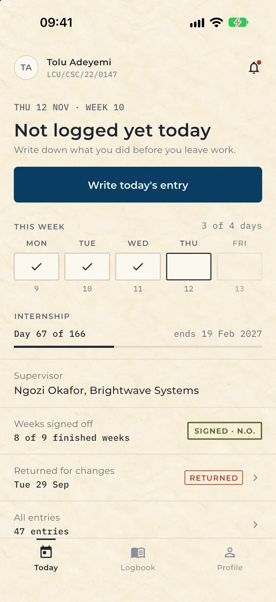
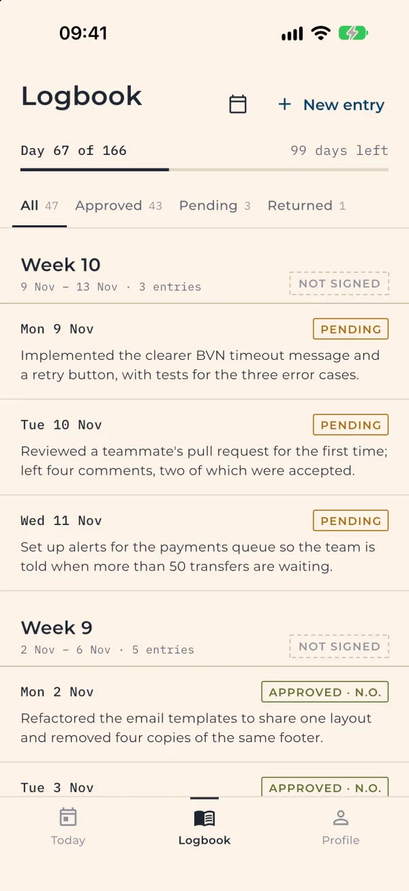
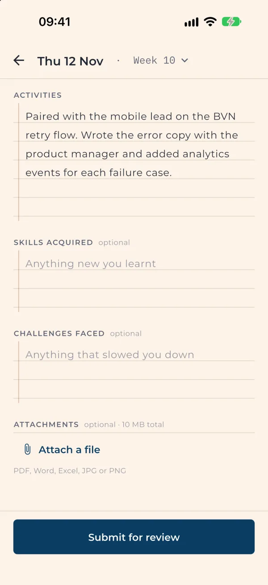
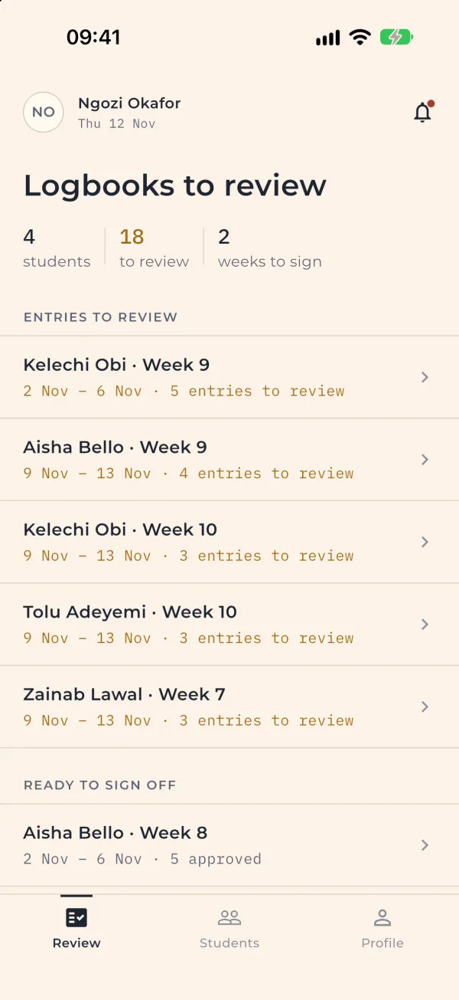
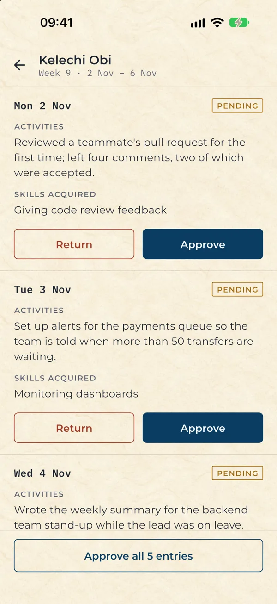
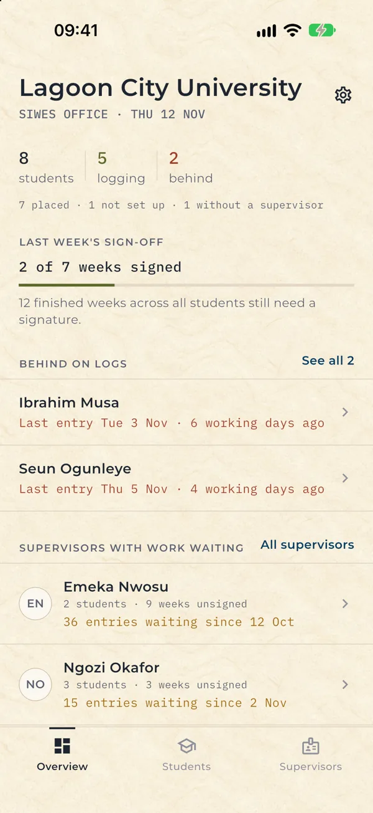
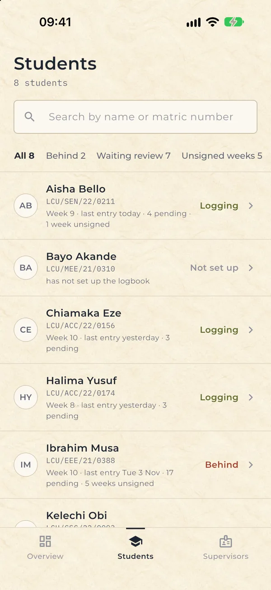
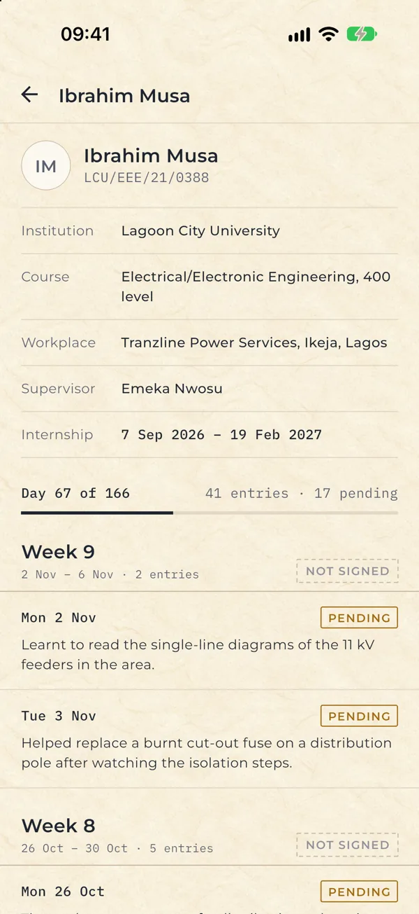
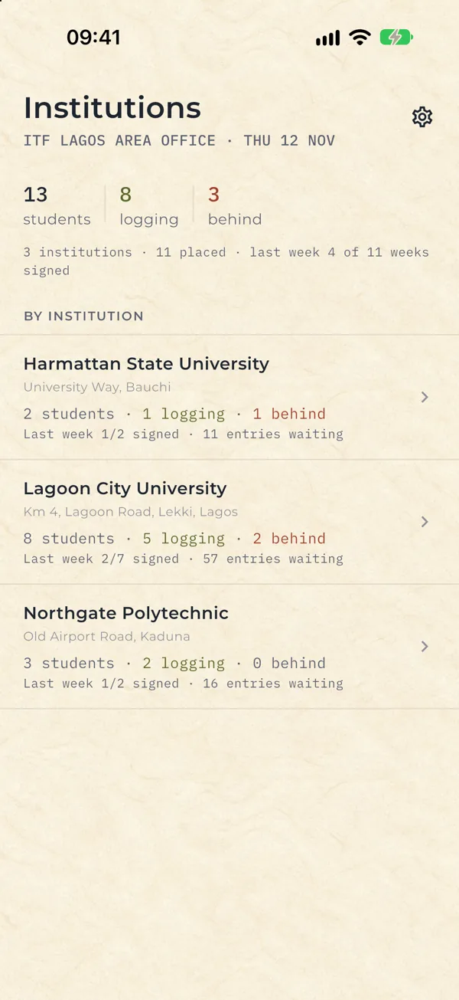

# SIWES360

A Flutter app that replaces the paper SIWES logbook: students log their daily industrial-training work, their workplace supervisors review each entry and sign off each week, and their institution's SIWES office and the ITF follow how every student is doing.

SIWES (Students Industrial Work Experience Scheme) is Nigeria's compulsory industrial-training programme for university and polytechnic students, run by the Industrial Training Fund (ITF). SIWES360 gives each of the four roles its own screens, backed by a REST API.

## Screenshots

| Today | Logbook | New entry |
| :---: | :---: | :---: |
|  |  |  |
| Has today been logged, this week's days, and the day count | Entries a week at a time, with stamps and the weekly sign-off | The date is the title; writing goes on ruled lines |

| Supervisor's queue | Reviewing a week | Coordinator overview |
| :---: | :---: | :---: |
|  |  |  |
| Work grouped by student and week | Approve or return each entry, then sign the week | Who is logging, who is behind, who has work waiting |

| Coordinator's students | A student's record | ITF institutions |
| :---: | :---: | :---: |
|  |  |  |
| Filter by behind, waiting review, unsigned weeks | Placement details and the whole logbook | Every institution at a glance, read-only |

## Features

### Student

- **First-login setup:** internship start and end dates, workplace, and the workplace supervisor. Typing a supervisor's name searches registered supervisors and links the account, so that supervisor can review the student's logs.
- **Today:** whether today's entry is written, this week's Monday to Friday marks (logged, missed, today), "Day 58 of 166", the supervisor, weeks signed off, and any entry returned for changes.
- **Daily entries:** the date is the title ("Tue 3 Nov · Week 9"). Activities (at least 20 characters), and optional skills acquired and challenges faced, on ruled lines. PDF, Word, Excel, JPG or PNG attachments up to 10 MB in total.
- **Logbook:** entries grouped by internship week (Monday to Sunday; week 1 holds the start date), each with a stamp such as `APPROVED · N.O.`, and each week with the supervisor's sign-off. Filter by status or open any date. Pending and returned entries can be edited or deleted; editing a returned entry sends it back for review.
- **Profile:** official details from the institution are locked ("Official records cannot be edited"); internship details stay editable. The profile photo stays on the device.
- **Notifications** for approvals, returns and sign-offs.

### Workplace supervisor

- **Self-registration** (name, email, phone, organisation, position). Students and school admins are not self-registered; their institution gives them their login.
- **Review queue:** a list of student-weeks with entries to review ("Tolu Adeyemi · Week 10 · 2 entries"), oldest first, and weeks ready to sign off, with the counts on one line.
- **Week review:** each entry in full with Approve or Return (a comment is required to return one), Approve all, then the **weekly sign-off** with an optional comment, like the signature at the foot of a paper logbook page. A week can be signed once every entry in it is reviewed, from its Friday.
- **Students:** search, filter by entries to review, and open any student's whole logbook.

### Institution SIWES coordinator (admin)

Only the students of the admin's own institution.

- **Overview:** students, how many are logging and how many are behind (no entry for 3 or more working days), how many are placed or have not set up their logbook, last week's sign-offs, the students furthest behind, and supervisors with entries waiting (with the oldest waiting date).
- **Students:** where each student stands, filterable by behind, waiting review, unsigned weeks, not set up and no supervisor. Opens a student's placement details and logbook, read-only.
- **Supervisors:** each supervisor's entries waiting and unsigned weeks, counting only this institution's students.

### ITF

- **Institutions:** totals across every institution and, for each one, students placed, logging and behind, entries waiting and last week's sign-offs. Opens an institution's students and any student's logbook, read-only.

### Shared

- Email and password sign-in against a JWT-issuing backend, with automatic sign-in on launch while the stored token is still valid.
- Change password, the ITF website link, and sign-out in Settings.

### Not included yet

- Account management for admins in the app (creating student accounts, linking students to the institution, grading). The API has these; the app does not show them.
- ITF officers see every institution; there is no filtering by ITF area office yet, because institutions have no region on record.
- Push and email notifications, and biometric sign-in.

## Tech stack

| Area | Choice |
| --- | --- |
| Framework | Flutter (Dart SDK `^3.9.2`) |
| Networking | `dio`, with an interceptor that attaches the bearer token |
| Local storage | `hive` / `hive_flutter` |
| State management | `StatefulWidget` state on each screen |
| Models | `json_annotation` + `json_serializable` (generated `*.g.dart`) |
| Files and media | `file_picker`, `image_picker`, `path_provider` |
| UI | One token file (`lib/theme/tokens.dart`) and shared paper components (`lib/widgets/`); Montserrat, with IBM Plex Mono for dates, matric numbers and counts (Google Fonts); `intl`, `url_launcher` |
| Backend | Node.js, Express and MySQL: [siwes360Backend](https://github.com/mofixiu/siwes360Backend) |

## Architecture

### State management

Screens are `StatefulWidget`s. Each one loads its data from the API in `initState` and keeps it in local state, with loading, error and retry states.

### Design system

Every colour, type size, space and radius lives in `lib/theme/tokens.dart`; screens use the components in `lib/widgets/` rather than styling widgets themselves. The look is a filled-in paper logbook: cream paper and thin rules instead of cards, review statuses as small outlined stamps (`APPROVED · N.O.`), a heavier stamp for the weekly sign-off, IBM Plex Mono for dates, matric numbers and counts, muted olive, ochre and brick for status, and navy only for things you can press.

### Internship weeks

Weeks run Monday to Sunday and week 1 is the week that holds the internship start date. The app (`lib/utils/internship_calendar.dart`) and the backend (`utils/weeks.js`) use the same rule, so the week a supervisor signs is the week the student sees.

### Authentication flow

1. **Login:** `POST /auth/login` returns a JWT and the user record, with role-specific fields under `role_data`.
2. **Storage:** the token is written to the Hive box `auth` (key `token`). The merged user and role data are written as JSON to the Hive box `user` (key `userData`).
3. **Request auth:** a Dio interceptor reads the token and sends it as `Authorization: Bearer <token>` on every request.
4. **Routing:** `RoleRouter` (`lib/utils/role_router.dart`) maps the stored `role` to a home screen: `StudentDashboard`, `SupervisorDashboard`, `AdminOverview` or `ItfOverview`. A student whose `role_data.is_first_login` is set goes to `FirstLoginSetup` first.
5. **Auto-login:** on launch, `SplashScreen` loads the token and user data and validates them with `GET /auth/profile`. A valid session goes straight to the role's dashboard. An invalid or missing session is cleared and the user is sent to login.
6. **Logout:** both Hive boxes are cleared and the in-memory token is dropped.

### API layer

All HTTP calls go through `RequestService` in `lib/utils/request.dart`. It is a static wrapper around a single Dio instance (10-second connect and receive timeouts). It exposes typed methods for each resource: auth, students, daily logs, supervisors and notifications. It also has generic `get`, `post`, `put`, `patch` and `delete` helpers that turn errors into a `{status, message}` map instead of throwing.

The base URL is chosen by platform at the top of `request.dart`:

| Platform | Host |
| --- | --- |
| Android emulator | `http://10.0.2.2:3001` |
| iOS simulator, web, desktop | `http://localhost:3001` |

All requests go to `<host>/api`.

## Getting started

### Prerequisites

- Flutter with Dart SDK `^3.9.2` (`pubspec.yaml`)
- A running instance of the [SIWES360 backend](https://github.com/mofixiu/siwes360Backend), listening on port `3001`

### Run

```bash
git clone https://github.com/mofixiu/siwes360.git
cd siwes360
flutter pub get
flutter run
```

### Configuration

The app needs no API keys or `.env` file. The backend host is chosen in `lib/utils/request.dart`:

- **Emulator or simulator:** the defaults work if the backend runs on the same machine on port `3001`.
- **Physical device:** pass your machine's LAN address, for example `flutter run --dart-define=API_HOST=http://192.168.1.20:3001`.

Student and school-admin accounts are created on the backend, not in the app. Workplace supervisors can register from the sign-in screen.

### Demo data

The backend can build a separate demo database with made-up institutions, students, supervisors, a school admin and an ITF officer (`npm run seed:demo`, then `DB_NAME=siwes360_demo npm start`; see the backend README). The demo accounts and password are listed in its `database/seed_demo.js`.

If you change a model in `lib/models/`, regenerate the serialisers:

```bash
dart run build_runner build --delete-conflicting-outputs
```

## Project structure

```
lib/
├── main.dart                 # App entry: Hive, RequestService, the theme
├── theme/                    # tokens.dart (colours, type scale, spacing, radii) and the ThemeData
├── widgets/                  # Paper components: rules, ledger rows, stamps, ruled text areas,
│                             # week marks, the drawn logo, the bottom bar, the splash screen
├── auth/                     # Sign in, supervisor registration, password reset
├── models/                   # json_serializable models (user, student, supervisor, daily_log, ...)
├── screens/
│   ├── student/              # Today, logbook, new entry, entry sheet, first-login setup, profile
│   ├── supervisor/           # Review queue, week review and sign-off, students, profile
│   ├── admin/                # Institution overview, students, supervisors
│   ├── itf/                  # Institutions and an institution's students
│   └── shared/               # Student record, student list, notifications, settings
└── utils/                    # RequestService (API + storage), session, internship calendar, RoleRouter
```

## Author

Built by **Mofiyinfoluwa Ebo** ([@mofixiu](https://github.com/mofixiu)), who designed and built both the Flutter app and the [Node.js backend](https://github.com/mofixiu/siwes360Backend).

Portfolio: [mofiyinebo.com](https://mofiyinebo.com)
